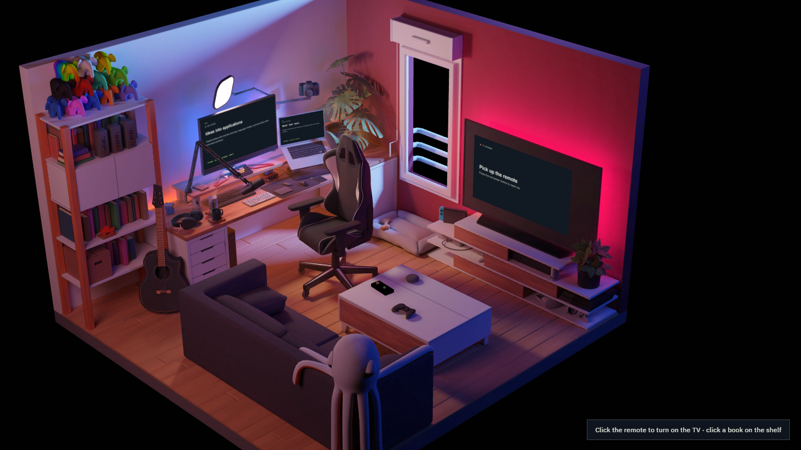
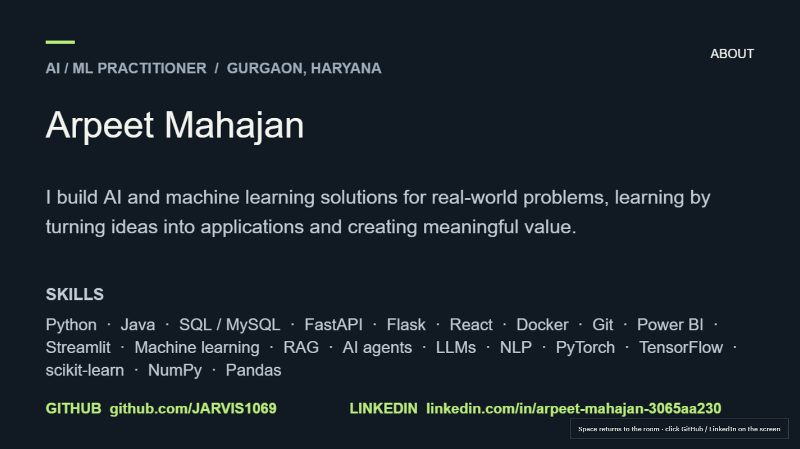
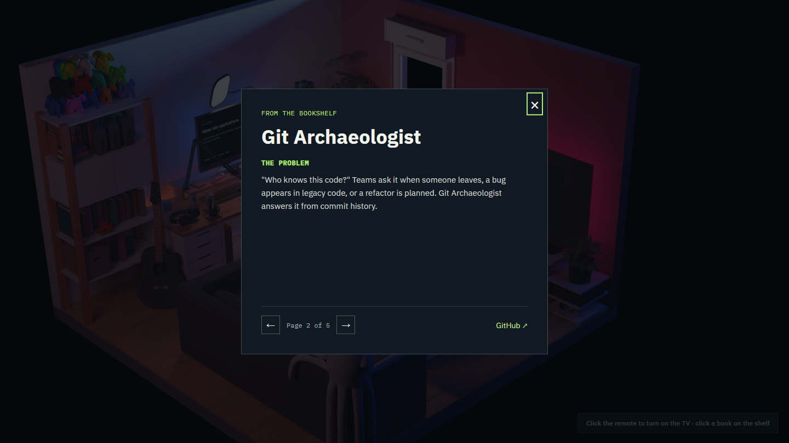

# Portfolio

An interactive 3D-room portfolio for **Arpeet Mahajan**, an AI / ML practitioner based in Gurgaon, Haryana.

**Live:** https://jarvis1069.github.io/Portfolio/



## How it works

- **Remote on the coffee table:** click it to switch the TV on. The camera moves straight in front of the screen, which shows the About page with skills and working GitHub and LinkedIn links. Press `Space` to switch off and return to the room.
- **Books on the shelf:** each project is one of the books already on the bookshelf. Click a book to open it as a five-page book (title and tech stack, then the idea, how it works, features and delivery), with a link to the repository. Turn pages with the on-screen arrows or the left / right arrow keys.
- **Free camera:** drag to orbit, scroll to zoom, and right-drag (or Shift-drag) to pan.

| TV | Project book |
|---|---|
|  |  |

## Projects

- [Multi-Agent AI Organization System](https://github.com/JARVIS1069/Company-AI)
- [Git Archaeologist](https://github.com/JARVIS1069/GIT-archaeologist)
- [FinTrust](https://github.com/JARVIS1069/FinTrust-Loan-Recommendation-System-main)

## Develop

Requires Node.js.

```bash
npm install
npm run dev     # http://localhost:8080
npm run build   # outputs to dist/
```

On Node 17+ the older webpack needs `NODE_OPTIONS=--openssl-legacy-provider` for `npm run build`.

Content lives in `src/Experience/Portfolio.js`. Open `/#books` to highlight the clickable book areas.
